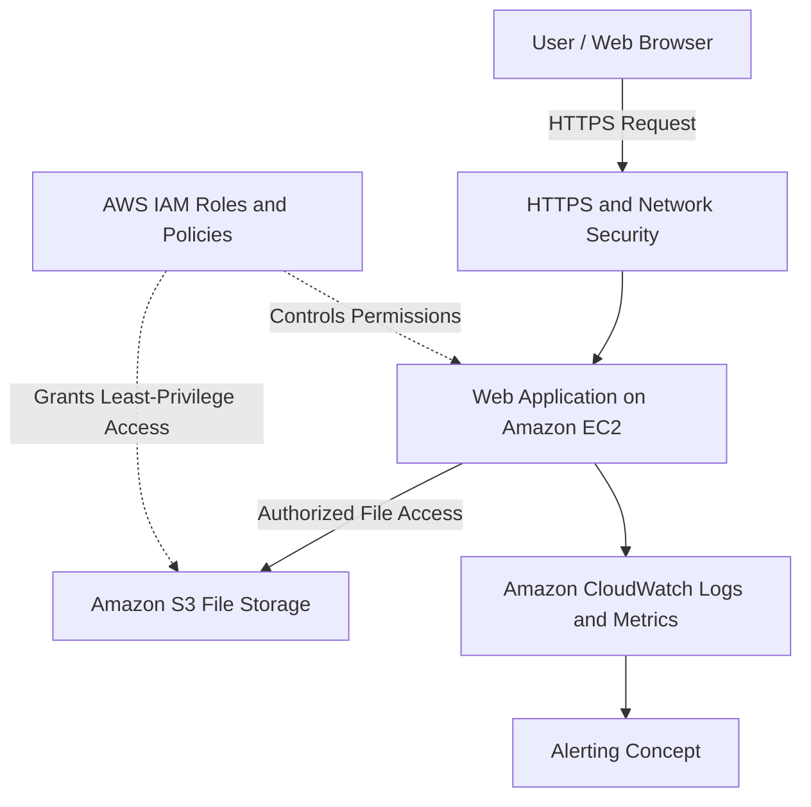

# SWYNEX Cloud Architecture Outline

## 1. Project Overview

This project presents a conceptual cloud architecture for hosting a simple web application using Amazon Web Services (AWS). It describes the compute, storage, networking, identity and access management, monitoring, security, and cost considerations required for a basic cloud-hosted workload.

**Project:** Cloud Architecture Outline  
**Domain:** Cloud Computing  
**Cloud Provider:** Amazon Web Services (AWS)  
**Architecture Type:** Conceptual design for a web application  
**Internship Task:** Task 1

> Note: This document describes a proposed architecture. AWS resources have not been deployed or tested as part of this document.

## 2. Objectives

The objectives of this project are:

- Identify appropriate cloud compute and storage services.
- Explain basic cloud networking and connectivity.
- Describe identity and access management.
- Propose monitoring and alerting mechanisms.
- Identify security controls and cost-management practices.
- Document a potential deployment approach.

## 3. Proposed Cloud Architecture

The architecture uses Amazon EC2 to host a web application, Amazon S3 for file storage, AWS IAM for permissions, and Amazon CloudWatch as a proposed monitoring service.

### Architecture flow

1. A user accesses the application through a web browser using HTTPS.
2. Network security rules control which connections can reach the application.
3. Amazon EC2 provides compute capacity to run the application.
4. Amazon S3 stores application files and other required objects.
5. AWS IAM roles and policies control access to AWS resources.
6. Amazon CloudWatch can collect logs and metrics and support alerts.

This diagram is conceptual and does not represent a deployed AWS environment.

## 4. Compute

### Proposed service: Amazon EC2

Amazon Elastic Compute Cloud (EC2) provides virtual servers that can run web applications and APIs.

**Purpose:**
- Host the application.
- Process incoming requests.
- Execute application logic.
- Communicate with permitted storage services.

**Security and management considerations:**
- Select an instance size appropriate for the workload.
- Apply operating system and application updates.
- Expose only necessary network ports.
- Restrict administrative access.
- Monitor CPU and memory usage where supported.
- Stop or remove unused resources.

The appropriate instance type depends on the application's resource requirements.

## 5. Storage

### Proposed service: Amazon S3

Amazon Simple Storage Service (S3) provides object storage for files and other application data.

**Possible uses:**
- Uploaded documents.
- Static assets.
- Application reports.
- Backups and exported files.

**Security considerations:**
- Block public access unless it is explicitly required.
- Apply appropriate bucket policies.
- Use least-privilege IAM permissions.
- Enable encryption at rest.
- Consider versioning and lifecycle policies where appropriate.
- Review retention and backup requirements.

S3 is object storage, not a relational database. If structured transactional data is needed, a database service may be considered separately.

## 6. Networking

### Proposed components: Amazon VPC and security groups

An Amazon Virtual Private Cloud (VPC) provides a logically isolated network for AWS resources.

**Networking considerations:**
- Plan public and private network boundaries.
- Use HTTPS to protect data in transit.
- Restrict inbound traffic using security groups.
- Avoid exposing administrative ports to the public internet.
- Keep internal resources private wherever possible.
- Allow only necessary outbound connections.
- Consider a load balancer and multiple Availability Zones if higher availability is required.

For a production application, public entry points and private compute resources should be designed according to the application's security requirements.

## 7. Identity and Access Management

### Proposed service: AWS IAM

AWS Identity and Access Management (IAM) controls who can access AWS resources and which actions they can perform.

**Recommended practices:**
- Apply the principle of least privilege.
- Use IAM roles for application access to S3.
- Avoid hardcoding access keys in application code.
- Enable multi-factor authentication for privileged human accounts.
- Review permissions periodically.
- Protect credentials and rotate them when appropriate.

The application should receive only the permissions necessary for its functions.

## 8. Monitoring and Alerting

### Proposed service: Amazon CloudWatch

Amazon CloudWatch can collect supported AWS metrics, logs, and alarms.

**Monitoring objectives:**
- Observe compute resource utilization.
- Identify repeated application errors.
- Review application and system logs.
- Detect service availability issues.
- Provide alerts when defined thresholds are exceeded.

**Example alerting plan:**

| Metric or condition | Proposed action |
|---|---|
| Sustained high CPU utilization | Review workload and capacity |
| Repeated application errors | Investigate application logs |
| Application availability failure | Check application and network connectivity |
| Unexpected resource usage | Review workload and potential costs |

These are proposed monitoring measures. No CloudWatch alarms or dashboards have been configured as part of this conceptual document.

## 9. Security Considerations

The following controls should be considered when implementing the architecture:

- Use HTTPS for application traffic.
- Restrict network access to required services.
- Apply least-privilege IAM permissions.
- Keep S3 objects private by default.
- Encrypt data where appropriate.
- Patch operating systems and application dependencies.
- Protect credentials and secrets.
- Review logs and investigate unusual activity.
- Remove unused resources and permissions.

Security requirements should be reviewed before any production deployment.

## 10. Cost Considerations

Cloud costs depend on region, configuration, resource size, usage duration, data transfer, and applicable pricing.

**Cost-management practices:**
- Select appropriately sized compute resources.
- Stop or remove unused resources.
- Review storage usage and retention.
- Consider data-transfer charges.
- Review monitoring and logging costs.
- Set up AWS Budgets alerts where appropriate.
- Estimate expected expenses before deployment.

No actual deployment costs have been measured for this project.

**Pricing resources:**
- AWS Pricing Calculator: https://calculator.aws/
- AWS Pricing: https://aws.amazon.com/pricing/

## 11. Proposed Implementation Plan

If the conceptual design is implemented in a cloud environment, the following steps can be considered:

1. Define application requirements and expected traffic.
2. Plan the VPC, network boundaries, and security rules.
3. Select an appropriate compute service.
4. Deploy the application in a controlled environment.
5. Configure S3 storage and required IAM permissions.
6. Configure logging, metrics, and appropriate alerts.
7. Test application access and security controls.
8. Review costs and resource utilization.
9. Document test results and remove unused resources.

These are proposed steps, not completed deployment activities.

## 12. Expected Learning Outcomes

Through this architecture exercise, the intended learning outcomes are:

- Understand the purpose of cloud compute and storage.
- Explain how networking supports application access.
- Understand the role of identity and access management.
- Identify basic monitoring and alerting requirements.
- Recognize security and cost-management considerations.
- Communicate a cloud architecture using a diagram and technical documentation.

## 13. Conclusion

This project outlines a conceptual cloud architecture for a simple web application using AWS services. It explains how compute, storage, networking, identity, and monitoring can work together to support a cloud workload.

The design provides a foundation for further implementation, testing, security review, and cost estimation.

## 14. References

1. AWS Architecture Center: https://aws.amazon.com/architecture/
2. Amazon EC2: https://aws.amazon.com/ec2/
3. Amazon S3: https://aws.amazon.com/s3/
4. Amazon VPC: https://aws.amazon.com/vpc/
5. AWS IAM: https://aws.amazon.com/iam/
6. Amazon CloudWatch: https://aws.amazon.com/cloudwatch/
7. AWS Pricing Calculator: https://calculator.aws/
